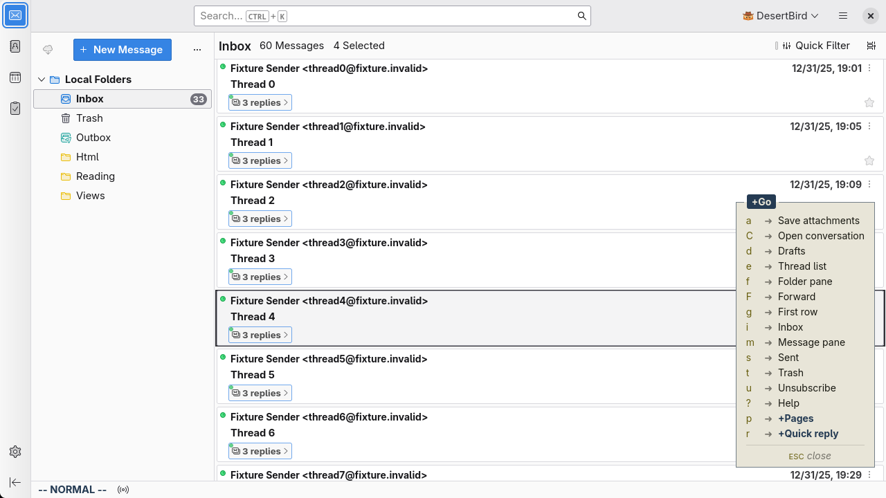
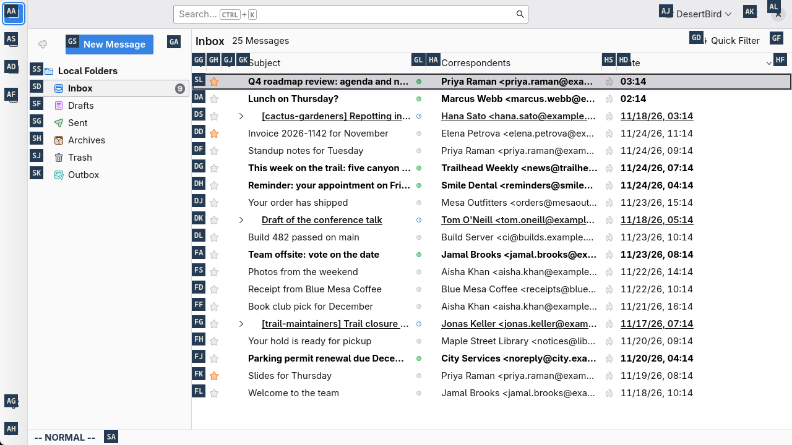
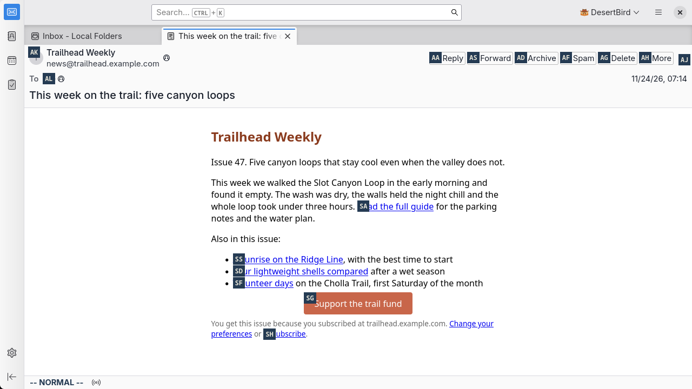
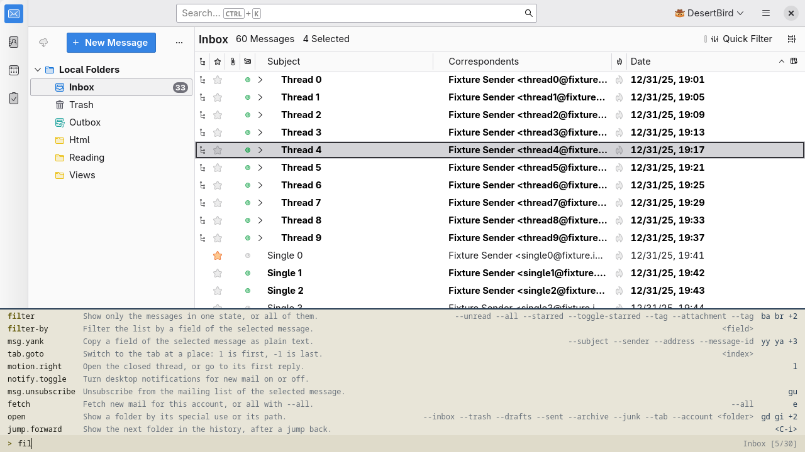
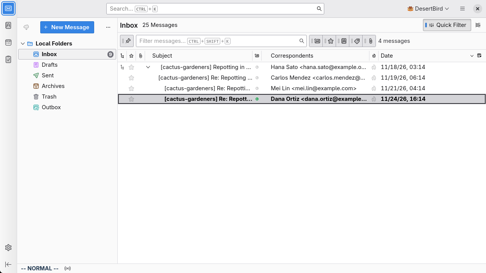
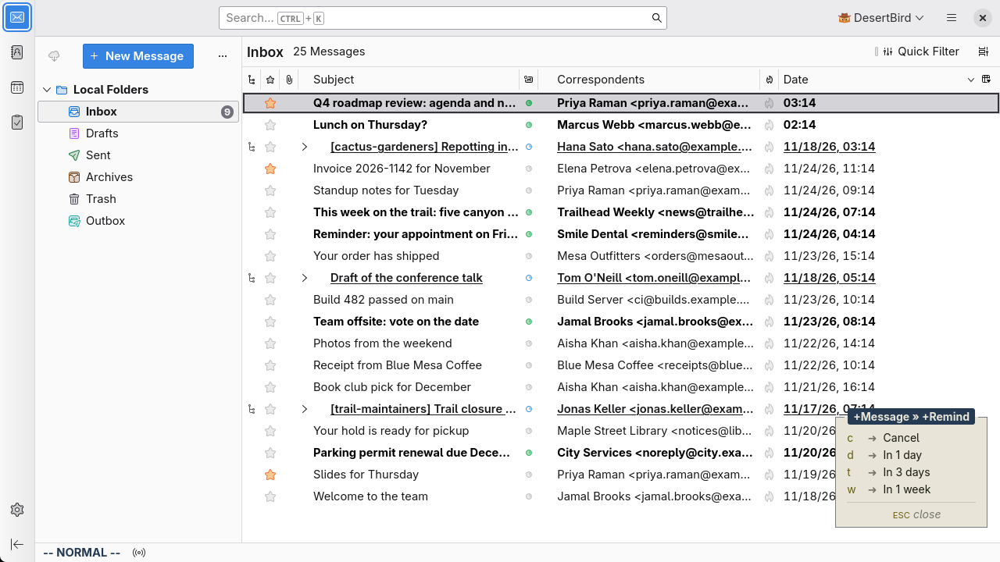
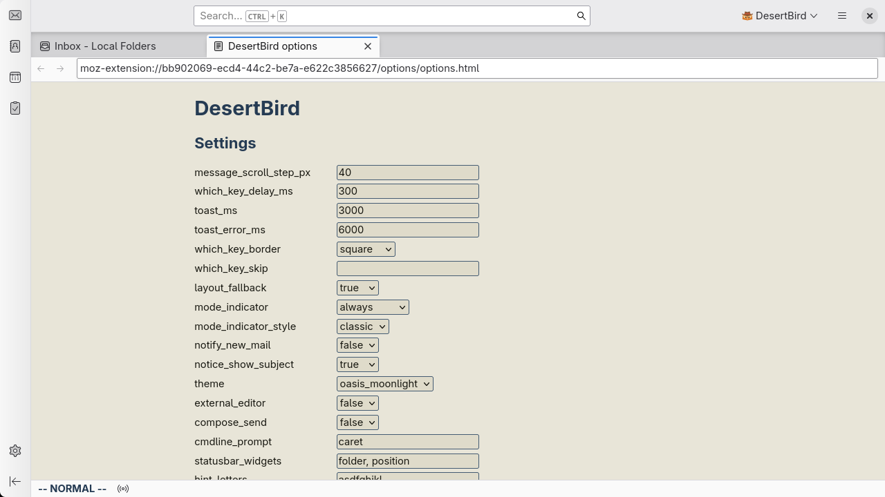

# 🐦 DesertBird

<p align="center"></p>

<hr/>

<p align="center">
  <a href="https://github.com/uhs-robert/desertbird/stargazers"></a>
  <a href="https://github.com/uhs-robert/desertbird/issues"></a>
  <a href="https://github.com/uhs-robert/desertbird/graphs/contributors"></a>
  <a href="https://github.com/uhs-robert/desertbird/forks"></a>
</p>

<p align="center"><i>Desert the mouse. Run your mail with your keyboard. The keys teach themselves.</i></p>
<p align="center">Vim keys for Thunderbird: a command line, a which-key popup and one registry that every key reads.</p>

<!-- TODO image: docs/images/demo.gif, 800 px wide. A short demo in the mail tab: j and k down the thread list, a to archive, r to reply, the which-key popup after g, the command line with completion, and a theme switch. -->

## 🐦 What it is

DesertBird puts Vim keys in Thunderbird (or Betterbird). It works in the mail tab, the message pane, message windows and the compose window. Press `j` and `k` to move through the thread list, `a` to archive, `r` to reply and `f` to put a short label on each control and pick one by typing it. Press `:` to run any command by name, with completion.

Every command is defined once in a registry. Keys, the command line, completion and help all read that definition. DesertBird follows the design of [DesertFox](https://github.com/uhs-robert/desertfox), its Firefox sibling. Use DesertFox for the browser and DesertBird for mail.

**The keys teach themselves.** Press a key that starts a longer sequence, such as `g`, and wait. A which-key popup (a popup that lists the keys that can follow and what each does) opens after a short pause. Press `Alt+?` or `,?` to open it with the top-level keys. Press `g?` or `,h` to open the help page, which lists every key.

<p align="center"></p>

You can edit a message in your own editor, such as Neovim: press `Ctrl+E` in the body of a compose window. This needs the native host (see [Install](#-install)) and an `editor.toml` that names your editor.

## 🏆 Why DesertBird

- **You learn it as you go.** A popup shows the keys that can follow a key that starts a sequence, and a help page lists every key. [Details](src/background/hud/README.md).
- **It checks what you give it.** A typo is an error with a message, never a silent no-op. Keys, the command line, the native host and snippets all pass through one validator. [Details](docs/design.md#principles).
- **It is safe by design.** DesertBird never runs the keys, commands or config lines you type as code. Its privileged part and its optional helper program take a fixed set of requests. [Details](docs/design.md#decisions).
- **It grows with you.** The first day needs a few keys. Marks, filters, snooze, reminders and your own bindings wait until you want them. See [Features](#-features).
- **It keeps its size in check.** Each script has a size guard, and raising one needs a reason. [Details](docs/design.md#bundle-size-guards).
- **It is tested with real key presses.** A test suite presses real keys in a real Thunderbird and Betterbird. See [`tools/e2e/README.md`](tools/e2e/README.md).

**DesertBird stays alive.** Its background page is persistent, so Thunderbird does not unload it on a timer and it is there for every key. Settings, marks and the keymap live in `storage.local`, so a restart of the page keeps them. Only a few seconds of interface state, such as the open command line, live in memory alone.

## 📦 Install

DesertBird runs in Thunderbird 153 ESR or later and in Betterbird. It is tested in Thunderbird 153 ESR and Betterbird 153. The native host is optional and Linux only.

### From addons.thunderbird.net

The listing on addons.thunderbird.net is not live yet. It is waiting for review. Until it is, install from source (below). This section gets the listing link once the review passes.

### What Thunderbird asks on install

Thunderbird shows a warning that DesertBird can "Have full, unrestricted access to Thunderbird, and your computer". Thunderbird words every add-on with an Experiment this way. An Experiment is the privileged part of a Thunderbird add-on. DesertBird needs one because the standard add-on API gives no keys in the mail window, no thread list cursor, no folder pane control and no keys in the compose window. [docs/thunderbird-behavior.md](docs/thunderbird-behavior.md) holds the measurements.

The Experiment takes a fixed table of requests, each with typed arguments. It has no way to run a script, a shell command or an address you type. [`docs/design.md`](docs/design.md#chrome-verbs) lists every request, and its source is open and not minified. Experiments are outside Thunderbird's API stability promise, so a new ESR can break one. See Known limits below.

The other permissions are the ones the commands need:

| Permission | What for |
| --- | --- |
| `accountsFolders`, `accountsRead` | Folder keys, completion over folders, move and copy, the Snoozed folder |
| `messagesRead`, `messagesUpdate`, `messagesTags`, `messagesTagsList` | Read a message, mark read, star, mark junk, tag |
| `messagesMove`, `messagesDelete` | Archive, move, copy and delete. `dd` moves a message to Trash, and in Trash it deletes for good |
| `messagesModify` | The script that gives keys and hints to a message you read |
| `compose`, `compose.save` | Reply, forward, new message, drafts, and the compose window keys. No `compose.send`: `gS` sends through Thunderbird's own command, and only with the `compose_send` setting on |
| `alarms` | Snooze and reminders |
| `notifications` | Result toasts, reminders and the optional new-mail notice |
| `storage` | Settings, keymap, marks, undo log, snoozes and reminders |
| `tabs` | Tab keys |
| `clipboardWrite` | The yank keys |
| `downloads` | `ga` saves attachments to `Downloads/DesertBird/` |
| `nativeMessaging` (optional) | The native host. Thunderbird asks for it when you save `external_editor` or `bridge` as true on the options page |

DesertBird makes no network request of its own. See [docs/privacy.md](docs/privacy.md).

### From source

Run `just build` (or `npm run build`). It writes an unsigned `dist/desertbird.xpi`. Install that file in Thunderbird or Betterbird. The file is unsigned and uses an Experiment, so set `xpinstall.signatures.required` to false and `extensions.experiments.enabled` to true, as the [measurement setup](docs/thunderbird-behavior.md#setup) does. See [AGENTS.md](AGENTS.md) for the build and check commands and [BUILD.md](BUILD.md) for the steps a store reviewer follows.

### Native host (optional)

The native host is the [DesertFox](https://github.com/uhs-robert/desertfox) host. It is a separate download and is not part of the add-on. You do not need it. Every key, the command line, the options page and the key editor work without it.

The host adds two things: editing a message in your own editor, and the bridge that lets a desktop bar or a script talk to Thunderbird. To set up the editor:

1. Install the host. Run the download and install in a new empty directory, because the download leaves `install.sh` in the current directory. The host needs `python3` 3.9 or newer, `curl` and `flock`. Take the version from the [latest DesertFox release](https://github.com/uhs-robert/desertfox/releases/latest). The installer wants the hash of each script, which the release publishes as `<script>.sha256` files:

   ```bash
   version=1.0.2
   base=https://github.com/uhs-robert/desertfox/releases/download/v$version
   hash_of() { curl -fsSL "$base/$1.sha256" | cut -d' ' -f1; }
   curl -fsSL -o install.sh "$base/install.sh"
   sh install.sh "$version" --sha256 "desertfox-host=$(hash_of desertfox-host)" --sha256 "desertfox-bridge=$(hash_of desertfox-bridge)" --sha256 "desertfox=$(hash_of desertfox)"
   ```

   The hashes come from the same release as the scripts, so they catch a damaged download and not a changed release. The installer writes the host files under `~/.local/share/desertfox/` and the host manifests under `~/.mozilla/native-messaging-hosts/`, including the `desertbird_host` and `desertbird_bridge` manifests for DesertBird and the `desertfox_host.json` and `desertfox_bridge.json` manifests for DesertFox Firefox. It also links `~/.local/bin/desertfox`. If a regular file already sits there, the installer keeps it and prints the path of the installed command line to run instead. Put `~/.local/bin` on your `PATH` to use the `desertfox` command line.

   The installer ends with "Return to Firefox or Thunderbird and press the permission button on the extension's page". For DesertBird this means step 3 below: turn on `external_editor` or `bridge` in the DesertBird options, press Save and allow the `nativeMessaging` prompt.

2. Create `~/.config/desertfox/editor.toml` and name your editor. The host has no default. This example opens Neovim in a floating `foot` terminal and quits after one save:

   ```toml
   argv = ["foot", "--app-id", "desertfox-editor", "nvim", "-n", "+set noundofile nobackup", "+autocmd BufWritePost <buffer> quit", "{file}"]
   insert_argv = ["+normal! G", "+startinsert!"]
   ```

   The terminal must stay in the foreground until the editor quits. The [host README](https://github.com/uhs-robert/desertfox/blob/main/host/README.md) explains each field.

3. On the DesertBird options page, set `external_editor` to true and press Save. Thunderbird asks once for the `nativeMessaging` permission. Allow it.

4. Open a compose window, click in the body and press `Ctrl+E`. Save and quit the editor, and the text goes back into the draft. Without the host or the file, `Ctrl+E` shows a message that names what is missing.

The bridge needs the same host and the `bridge` setting, see [`src/background/bridge/README.md`](src/background/bridge/README.md#setup). It is off by default.

## 🚀 Try it

The first day needs a few keys. Press `g` and wait: a short pause after a key that starts a sequence shows the keys that can follow.

| Key | What it does |
| --- | --- |
| `j` and `k` | Move down and up the thread list |
| `a` | Archive |
| `r` | Reply |
| `dd` | Delete (to Trash, and for good when the message is already in Trash) |
| `u` | Undo |
| `f` | Label every control, then type a label to use it |
| `/` | Search the folder in view |
| `:` | The command line, with completion |
| `,h` | The help page |
| `Alt+?` | The which-key popup with the top-level keys |

<p align="center"></p>
<p align="center"></p>
<p align="center"></p>
<p align="center"></p>
<p align="center"></p>

The toolbar button opens a small popup with two entries, Options and Help. Options holds the settings, the key editor and the 16 Oasis themes. [docs/keymap.md](docs/keymap.md) lists every default key of each tab kind.

<p align="center"></p>

## 🔍 How it compares

DesertBird and tbkeys both put custom keys into Thunderbird. They differ in what comes with the keys.

| Feature | DesertBird | tbkeys |
| --- | --- | --- |
| Key sequences | ✅ | ✅ |
| Plain keys in the main window | ✅ | ✅ |
| Plain keys in the compose window | ✅ | ❌ |
| Keys in standalone message windows | ✅ | ❌ |
| Key popup (which-key) | ✅ | ➖ |
| Command line with completion | ✅ | ➖ |
| Hints | ✅ | ➖ |
| Generated help | ✅ | ➖ |
| Keys set in a form on the options page | ✅ | ❌ JSON text |
| Runs code from a string | never | ✅ eval (not in tbkeys-lite) |
| Uses an Experiment | ✅ | ✅ |
| Published on addons.thunderbird.net | ❌ not yet, pending review | tbkeys-lite only |

✅ yes · ❌ no · ➖ not documented in its README

Sources, read in November 2026: the tbkeys [README](https://github.com/wshanks/tbkeys#readme) and the DesertBird docs in this repository.

- Key sequences and plain keys: the README says tbkeys "uses Mousetrap to bind key sequences to custom commands", and its default main window keys are modeled on GMail.
- Windows: the README has separate fields for the main window and the compose window, and says "Key bindings do not fire in other windows."
- Compose: the README says "Key bindings do not fire in text input fields unless the first key combo includes a modifier other than `shift`", and a compose body is a text field. DesertBird has a normal mode there (see [docs/keymap.md](docs/keymap.md)).
- Format: bindings are a JSON object in the preferences pane, and a value that matches no command prefix is run as eval code.
- Eval: the README says tbkeys-lite is "a version of tbkeys with the ability to execute arbitrary javascript removed" and is the version published on Thunderbird's Add-ons page. The main tbkeys installs from a `tbkeys.xpi` file.
- Experiment: the README says tbkeys asks for permission to "Have full, unrestricted access to Thunderbird, and your computer" because it injects a key listener, and that its logic is a MailExtension experiment. DesertBird uses an Experiment for the same reason (see [docs/design.md](docs/design.md#principles)).
- DesertBird rows: [docs/keymap.md](docs/keymap.md) for the windows and keys, and [docs/design.md](docs/design.md#principles) for the registry and the ban on string eval.

> [!NOTE]
> A ➖ means the tbkeys README does not mention it. It does not mean tbkeys cannot do it.

<details>
<summary><b>🧭 Where another tool fits better</b></summary>

- You want your own key map in a few lines of JSON, with nothing else. tbkeys binds a key to a command and leaves the rest alone.
- You run eval commands of your own. tbkeys supports them and DesertBird leaves them out on purpose.
- You use Firefox for the web. Use [DesertFox](https://github.com/uhs-robert/desertfox), which has the same design.

</details>

## ✨ Features

- Move with `j` and `k`, and put a label on any control with `f`.
- Archive, reply, forward, delete, move, tag, star and mark as junk from the keyboard.
- Filter and sort the thread list, and search with `/`.
- Snooze a message, set a reminder, or reply from a stored text.
- Open tabs and message windows, switch panes and zoom.
- Repeat yourself with `.`, marks and visual select.
- Write in insert and normal mode, or in your own editor.
- Pick a theme, rebind keys and change settings on the options page.

Open a group for the details. [docs/keymap.md](docs/keymap.md) lists every default key.

<details>
<summary><b>🖱️ Move and read</b></summary>

- Move with `j` and `k`, jump with `gg` and `G`, and step ten rows with `Ctrl+d` and `Ctrl+u`.
- Put a label on the controls of the front tab with `f`, then type the label. The `;` keys do other things with a label, such as `;y` to copy.
- Switch panes with `H` and `L`, focus one with `gf`, `ge` and `gm`, and show or hide one with `wm` and `wf`. `wr` resizes a pane with the keys.
- Open the Inbox, Drafts, Sent and Trash with `gi`, `gd`, `gs` and `gt`.
- Step to the next or previous unread, starred or attachment message, or thread root, with `]u`, `[u`, `]s`, `[s`, `]a`, `[a`, `]t` and `[t`. `]U` and `[U` cross folders.
- Copy the subject, the sender, an address or the message id with `ys`, `yf`, `ya` and `yi`.

</details>

<details>
<summary><b>📬 Handle mail</b></summary>

- Archive with `a`, delete with `dd`, reply with `r`, reply to all with `R`, forward with `gF` and write a new message with `c`. `u` undoes.
- Folder tasks such as a new folder, rename or Empty Trash: focus the folder pane with `gf` and press `,m` for the context menu of the folder.
- Mark read or unread with `mr` and `mu`, star with `ms`, mark junk with `mj`, and tag, move or copy with `mt`, `mm` and `mc`.
- Reply with a stored text: `gr` and a digit from 1 to 9 pick one of nine quick replies. You write them on the options page.
- Snooze with `mz`, and ask for a reminder with `mf`. `mzl`, `mzt`, `mzw` and `mzm` snooze to later today, tomorrow, the weekend and Monday. `mfd`, `mft` and `mfw` remind in one day, three days and one week, and `mfc` cancels.
- Unsubscribe: `gu` reads the `List-Unsubscribe` header of the selected message. The first press shows a notification with the target: the host of an https link, or the address a mailto draft goes to. A second press of `gu` on the same message within 15 seconds acts. An https link opens in the default browser. A mailto opens a prefilled compose window, and you send it yourself. When the header has both, the mailto wins. The add-on never sends mail, fetches or posts a URL, or archives the message. It accepts https and mailto only.
- Save attachments: `ga` saves the attachments of the selected messages to `Downloads/DesertBird/<date>-<subject>/`. The command needs the `downloads` permission. File names and the subject are cleaned first, and a saved file is never opened. `msg.save_attachments {where: ask}` shows the save dialog for each file. A message with no attachments is refused.
- New-mail notifications are off by default, because Thunderbird shows its own new-mail alert. Turn them on with the `notify_new_mail` setting on the options page, or run `:notify.toggle`. Each new unread, non-junk Inbox message then shows a desktop notification with the sender and the subject. More than three at once give one notification with a count. Clicking a notification opens the message in a tab. The subject and sender show on the lock screen and in the desktop's notification history. The add-on needs no new permission.

</details>

<details>
<summary><b>🔍 Find and filter</b></summary>

- Search with `/` (forward) or `?` (backward), and move between matches with `n` and `N`. The search runs as a live Quick Filter search on the folder in view, and it matches the subject and the sender. Thunderbird's own `Ctrl+K` search, which covers all folders and message bodies, stays Thunderbird's.
- Filter the thread list: `bu` shows unread, `br` shows all, `bs` toggles starred, `ba` shows messages with attachments, `bt` filters by tag and `bf` opens a filter by text.
- Filter by the message at the cursor, also on a selected thread: `bmf` by sender, `bms` by subject, `bmr` by recipient, `bml` by mailing list and `bmd` by day. `bmt` filters by the tags of every selected message.
- Sort with `s` and a letter: `sd` by date, `sj` by subject, `sf` by author, `sz` by size, `su` by unread and more. `so` flips the current sort.
- Run any command by name with `:`. Open a folder with `o` and a tab list with `T`, both with completion.

</details>

<details>
<summary><b>🗂️ Tabs and windows</b></summary>

- Move between tabs with `J` and `K` (or `Alt+j` and `Alt+k`), close one with `q`, and jump to the first tab with `t0`, to the last with `t$` and to the alternate tab with `tl`. `T` opens a tab list.
- Open the selected message in a tab with `Ctrl+l`. `gC` opens its conversation.
- A message window has its own keys. Go to the next or previous message with the keys under Next and Previous in [docs/keymap.md](docs/keymap.md).
- Zoom with `zi` and `zo`, reset with `z=`, and fold threads with `zM` and `zR`.
- The keys also work in the options and help pages and in other tabs. The calendar and the address book get navigation, tab keys and hints, not commands of their own: `c` there still opens a new mail message, and there is no key for a new event or contact.

</details>

<details>
<summary><b>✍️ Compose</b></summary>

- Every compose window opens in insert mode, where all keys type. `Escape` in the body enters normal mode and `i` returns to typing. In normal mode no letter reaches the draft.
- In normal mode, `e` edits in the external editor, `s` saves a draft and keeps the window open, `?` and `,h` open the help page, and `zi`, `zo`, `z=` and the other zoom keys zoom the body.
- Chords such as `Ctrl+Enter` and `Ctrl+S` stay Thunderbird's. `q` closes the window through Thunderbird's own close command, so unsaved text gets its save prompt.
- The mode stays when the focus leaves the body and returns, and across a draft save.
- `Tab` and `Shift+Tab` are held back in normal mode. Chords such as `Ctrl+V` and `Ctrl+Z`, `Shift+Insert`, the Paste and Cut keys and a middle-click paste still work. A mouse paste, a drag, the context menu and an input method can still change the draft in normal mode.
- A user binding on `i`, on `Escape` or on a chord has no effect there. The other keys are rebindable.
- A small `-- INSERT --` or `-- NORMAL --` label shows the mode at the bottom right. The body and the To, Cc, Bcc and Subject fields share one mode: `Escape` in any of them enters normal mode and `i` returns to typing.
- In normal mode, `gt`, `gc`, `gb`, `gs` and `gm` jump to To, Cc, Bcc, Subject and the body. `gS` sends the message through Thunderbird's own send command, with its checks, but only while the `compose_send` setting is on. The setting is off by default. With it off, `gS` does nothing and the which-key popup leaves it out.
- External editor: it is off by default. Turn on the `external_editor` setting on the options page and press Save. Thunderbird asks once for the `nativeMessaging` permission, which the editor needs to reach the native host. Then press `Ctrl+E` in the body. With the setting on, `e` in normal mode does the same.
- The DesertFox native host opens your editor on the message text, and DesertBird writes the result back when you save and quit. The host runs the command in its `editor.toml` and has no default, so the host and that file must be set up first. The add-on reaches the host through its `desertbird_host` manifest.
- DesertBird writes back only when the text changed and the body in the window did not change meanwhile, and says why otherwise. Closing or sending the compose window while the editor is open discards the edited text. DesertBird keeps waiting for the editor, so the host can delete its scratch file when the editor closes.
- In an HTML message only your own text goes to the editor, as Markdown in a `.md` file. The quote, a forwarded message and the signature stay as Thunderbird wrote them. A reply with your text on both sides of the quote is refused.
- Markdown that would add a script, an event handler or a script link is stripped. Tables, underline and strike show as HTML in the Markdown.
- An image keeps its place when it is a web address, embedded image data, or a link to a stored mail part (`mailbox:`, `imap:`) that the message already held, which covers the image of a saved draft. An image with another source (a file, a `cid:` part, a mail part the message did not hold) is left out, and a message names the loss.

</details>

<details>
<summary><b>🔁 Repeat and remember</b></summary>

- Repeat the last command with `.`.
- Mark a place with `M` and return with `'`.
- Select a range of messages with `v` and move with `j`, `k`, `gg` and `G`. `Space` adds the current row to the selection or takes it out.
- Go back and forward through your jumps with `Ctrl+o` and `Ctrl+i`.

</details>

<details>
<summary><b>🎨 Make it yours</b></summary>

- Change settings and rebind keys on the options page. A binding the compiler skips blocks the save, so a typo never reaches storage.
- Pick one of the 16 Oasis themes with the `theme` setting. The options page, the which-key popup, the command line and the mode label follow it.
- Choose when the mode label shows with `mode_indicator`.
- Bridge: it is off by default and nothing connects until you turn it on. See [docs/privacy.md](docs/privacy.md) for what it can pass to programs on your own computer. The `bridge` setting lets the DesertFox bridge host connect, so a desktop bar can show the mode and a script can run a few safe commands, such as `pane.toggle folder` or `step.unread`. The add-on needs the `nativeMessaging` permission for this. It is an optional permission: Thunderbird shows "Exchange messages with programs other than Thunderbird" as a prompt when you turn `bridge` on and press Save on the options page. If you deny it, the setting is not saved. Nothing connects while `bridge` is off, which is the default. While it is on, the add-on sends the mode of the focused window and the ids of that window and its active tab, plus the list of commands the bridge allows. Commands that send mail, delete it for good or open a link never run through the bridge. Archive, trash and move run only when `bridge_allow_actions` is on and you press `y` on a prompt in Thunderbird.

Four more settings, each off by default and each inert while `bridge` is off, let a script read mail:

| Setting | What leaves Thunderbird |
| --- | --- |
| `bridge_share_folders` | Folder names, paths, account names and unread and total counts |
| `bridge_share_headers` | Sender, subject, date and read and flagged state of the messages in one folder, at most 200 at a time. Needs `bridge_share_folders` on too |
| `bridge_share_bodies` | The text of one message, with `bridge_share_headers` on too. HTML turns into plain text, the text is cut at 64 KiB, and an encrypted message is never sent |
| `bridge_share_attachments` | Attachment names, sizes and types. Never the files |

With all four off, the bridge sends no mail, no folder names and no tags.

Two settings let a script write, each off by default and inert while `bridge` is off:

| Setting | What it allows |
| --- | --- |
| `bridge_allow_drafts` | Save a plain-text draft in the Drafts folder: up to 10 To and 10 Cc addresses, a subject and a body of at most 64 KiB, from one of your identities. No Bcc and no attachments. The answer is only ok or a refusal, never mail data |
| `bridge_allow_actions` | Archive, move to Trash or move to a folder (with `bridge_share_folders` on) up to 50 messages, only after you press `y` on a prompt in Thunderbird. The prompt lists the subjects and senders and says the request came from outside. `n`, Escape or 30 s refuses. Nothing is deleted for good, and `u` moves the messages back. The answer is only a count or a refusal |

Saving a draft needs the `compose.save` permission, which Thunderbird shows on install. The bridge never sends mail, and the add-on does not hold the `compose.send` permission. Thunderbird saves a draft only from a compose window, so the window opens for a moment, and the add-on closes it once the draft is saved. You review the draft and press Send yourself. Setup of the host and the CLI is in [`src/background/bridge/README.md`](src/background/bridge/README.md#setup).

</details>

## 🏜️ Known limits

- Thunderbird 153 does not support action buttons on notifications, so DesertBird notifications have none.
- Some keys stay Thunderbird's, such as `Ctrl+Enter` and `Ctrl+S` in the compose window. A single key that is missing from a table reaches Thunderbird. See [docs/thunderbird-behavior.md](docs/thunderbird-behavior.md).
- The privileged part is an Experiment, and it can break when Thunderbird internals change between ESR releases. A fixed table of calls keeps the breakage in one small file. See [Risks](docs/design.md#risks).
- The `nativeMessaging` permission is optional. The options page asks for it when you save `external_editor` or `bridge` as true. A key or a bridge start with no grant refuses with a message that says how to grant it. The native host itself is optional too.
- A first install opens the help page once. An update does not.

## 🔒 Privacy

DesertBird has no account, no telemetry and makes no network requests of its own. Settings stay in Thunderbird storage on your device. The optional bridge talks only to programs on your own computer. See [docs/privacy.md](docs/privacy.md).

## 💛 Support

Report a problem or ask a question on the [issue tracker](https://github.com/uhs-robert/desertbird/issues). Releases are on the [releases page](https://github.com/uhs-robert/desertbird/releases).

DesertBird is free. If it saves you time, you can sponsor its development on [GitHub Sponsors](https://github.com/sponsors/uhs-robert). Nothing in the add-on asks for it.

## 🧭 Docs

- [docs/design.md](docs/design.md): architecture, scope and risks.
- [docs/keymap.md](docs/keymap.md): every default key.
- [docs/privacy.md](docs/privacy.md): what the add-on stores and what the optional parts can pass to programs on your computer.
- [BUILD.md](BUILD.md): how to rebuild the package from the source.
- [docs/thunderbird-behavior.md](docs/thunderbird-behavior.md): what Thunderbird allows, measured.
- [AGENTS.md](AGENTS.md): a code map and docs index for contributors.

## License

[MPL 2.0](LICENSE).

The add-on ships two third-party libraries as their unchanged release files, each under the MIT license: [`marked`](vendor/marked/VENDOR.md) and [`turndown`](vendor/turndown/VENDOR.md). Their license texts are in `vendor/marked/LICENSE` and `vendor/turndown/LICENSE`.
